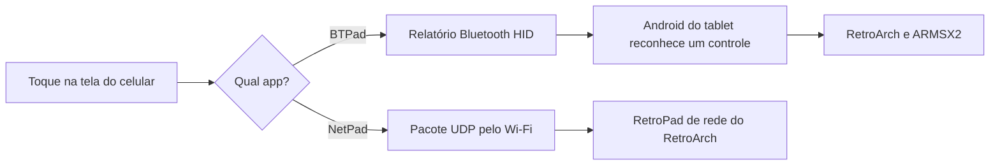

# Otimização de Tablets Samsung / Android e Console Retrô

Guia, especificação técnica e ferramenta interativa em Python para deixar tablets Android antigos mais leves, recuperar espaço e memória RAM e transformá-los em centrais multimídia ou consoles de emulação, **sem root**. O projeto explica por que esses aparelhos ficam lentos, automatiza a limpeza de bloatware e a otimização via ADB, auxilia na atualização do Android e configura emuladores de PS1, PS2 e outros consoles, além de dois apps que transformam o celular em controle.

Foi desenvolvido, homologado e medido em dois modelos reais da Samsung:
1. **Samsung Galaxy Tab A8 (`SM-X200`)** — Android 14, One UI 6, chip Unisoc T618 e 3,4 GB de RAM (foco em console de emulação dedicado).
2. **Samsung Galaxy Tab A 10.1 2019 (`SM-T510`, `gta3xlwifi`)** — Android 11 (`RP1A.200720.012.T510XXS5CVL1`), One UI Core 3.1, chip Exynos 7904 e 2 GB de RAM (foco em uso multimídia mantendo apps de Streaming, Gmail, YouTube e Fotos).

Em qualquer modelo Samsung ou Android, basta dar dois cliques no aplicativo gráfico nativo para Windows [`OtimizadorTabletSamsung.exe`](OtimizadorTabletSamsung.exe) (ou [`Otimizador_Tablet_App.bat`](Otimizador_Tablet_App.bat), que abrem a interface visual sem precisar de Python instalado) ou usar a versão de terminal em Python [`otimizador_tablet.py`](otimizador_tablet.py) ([`iniciar_otimizador.bat`](iniciar_otimizador.bat)).

> [!WARNING]
> **Termo de Uso e Isenção de Responsabilidade:**  
> Todas as alterações realizadas no aparelho por meio dos scripts, comandos ADB ou aplicativos deste repositório são de **inteira e exclusiva responsabilidade de quem os estiver executando**. Embora os métodos descritos não exijam root e operem de forma reversível para o usuário atual (`--user 0`), o autor e os colaboradores não se responsabilizam por eventuais perdas de dados, falhas de funcionamento ou uso indevido. Faça sempre backup dos seus arquivos importantes antes de iniciar.

## Conteúdo

- [Ferramenta interativa em Python (Menu)](#ferramenta-interativa-em-python-menu)
- [Resultados medidos](#resultados-medidos)
- [Por que os tablets ficam lentos](#por-que-os-tablets-ficam-lentos)
- [O que é obsolescência programada](#o-que-é-obsolescência-programada)
- [Como o projeto funciona](#como-o-projeto-funciona)
- [O que há no repositório](#o-que-há-no-repositório)
- [Requisitos](#requisitos)
- [Otimizar o tablet](#otimizar-o-tablet)
- [Atualizar a versão do Android](#atualizar-a-versão-do-android)
- [Medir o seu ganho](#medir-o-seu-ganho)
- [Instalar os emuladores](#instalar-os-emuladores)
- [Usar o celular como controle](#usar-o-celular-como-controle)
- [Compilar os apps](#compilar-os-apps)
- [Usar com um agente de IA](#usar-com-um-agente-de-ia)
- [Problemas comuns](#problemas-comuns)
- [Direitos autorais](#direitos-autorais)
- [Fontes](#fontes)
- [Licença](#licença)

## Ferramenta interativa em Python (Menu)

Para executar todo o processo sem precisar digitar comandos ADB manualmente, dê dois cliques em [`iniciar_otimizador.bat`](iniciar_otimizador.bat) ou rode:

```powershell
python otimizador_tablet.py
```

O script verifica e baixa o ADB oficial do Google automaticamente caso não esteja instalado, oferecendo 8 módulos no menu:
- **`[1]` Conectar ao Tablet:** USB, autorização e ativação automática de **ADB via Wi-Fi**.
- **`[2]` Diagnóstico e Varredura Completa:** Lê hardware, RAM, armazenamento, animações e bloatware ativo, salvando [`varredura-tablet.txt`](varredura-tablet.txt).
- **`[3]` Remover Bloatware e Limitadores Samsung:** Remove por categoria (1 a 12) ou em lote seguro, criando backup automático em [`antes.txt`](antes.txt), [`removidos.txt`](removidos.txt) e o script [`restaurar_apps.bat`](restaurar_apps.bat).
- **`[4]` Otimizações de Sistema:** Desliga animações (escala `0`), limpa caches (`pm trim-caches 999G`) e pré-compila os apps no runtime ART (`speed` / `speed-profile`).
- **`[5]` Medir Ganho de Desempenho:** Compara RAM disponível, pacotes ativos e tempo médio de abertura de aplicativos antes e depois.
- **`[6]` Reverter Alterações:** Reinstala pacotes removidos (`cmd package install-existing`) e restaura as animações.
- **`[7]` Utilitários de Emulação:** Cria as pastas `/sdcard/ROMs/...`, configura o `retroarch.cfg` (32 bits `ra32` e 64 bits `aarch64`) e gera arquivos `.cue` de PS1.
- **`[8]` Verificar / Iniciar Atualização do Android:** Checa versão atual, Patch de Segurança, CSC, suporte a Project Treble (GSI) e reinicia em Modo Download (Odin) ou Recovery.

## Resultados medidos

O ganho varia conforme o aparelho e quais aplicativos o usuário decide manter. Estes foram os números reais medidos nos dois modelos homologados:

### 1. Samsung Galaxy Tab A8 (`SM-X200` — Android 14, 3,4 GB RAM)
*Perfil: Console de emulação dedicado (sem conta Google e sem apps de streaming).*

| Medida | Antes | Depois |
| --- | --- | --- |
| Apps ativos | 333 | 267 (-66 ativos / 68 removidos) |
| RAM livre | cerca de 1,4 GB | cerca de 1,9 GB logo após o processo (~1,7 GB em uso normal) |
| Animações da interface | ligadas | desligadas |
| Limitadores de jogos da Samsung | ativos | removidos |

### 2. Samsung Galaxy Tab A 10.1 2019 (`SM-T510` — Android 11, 2 GB RAM)
*Perfil: Uso multimídia e cotidiano (mantendo Netflix, Disney+, Prime Video, Spotify, YouTube, YouTube Kids, Gmail, Google Fotos, Chrome e ChatGPT).*

| Medida | Antes | Depois |
| --- | --- | --- |
| Apps ativos | 336 | 271 (**67 pacotes de bloatware removidos**) |
| Espaço livre interno (`/data`) | 4,0 GB (84% cheio) | **5,2 GB** (79% cheio — **+1,2 GB recuperados**) |
| Animações da interface | ligadas (`1.0`) | desligadas (`0.0`) |
| Limitador de jogos (`GOS`) | ativo | removido |
| Compilação ART | padrão | híbrida (`speed` na UI + `speed-profile` nos apps grandes) |
| Serviços Samsung no Top 20 de RAM | vários ativos | **nenhum** (100% da RAM dedicada ao sistema e aos apps do usuário) |

Veja o relatório completo do `SM-T510` em [`Passo-a-passo-Galaxy-Tab-A-SM-T510.md`](Passo-a-passo-Galaxy-Tab-A-SM-T510.md) e a especificação técnica em [`SPEC.md`](SPEC.md).

Situação de cada parte:

| Parte | Situação | Evidência |
| --- | --- | --- |
| Otimização do tablet (`SM-X200` e `SM-T510`) | Funciona | Medidas das tabelas acima |
| Otimizador Interativo em Python (`otimizador_tablet.py`) | Funciona | Testado e validado via ADB no `SM-T510` (`RX2N7010CWF`) |
| RetroArch (PS1 e outros) | Funciona | Resident Evil 3 abriu no PCSX-ReARMed; os demais núcleos foram instalados, mas nem todos testados com jogo |
| PS2 (ARMSX2 — apenas tablets 64 bits como Tab A8) | Funciona no jogo testado | GTA III a cerca de 30 FPS e 100% de velocidade em um teste de cerca de 8 minutos |
| BTPad (controle Bluetooth) | Funciona | O tablet recebeu botões, setas e analógico de um POCO X5 Pro 5G |
| Tela de configuração do BTPad | Testada só no tablet | Falta confirmar no celular |
| Dois celulares ao mesmo tempo | Não testado | |
| NetPad (controle por Wi-Fi) | Funciona, com atraso | Ficou lento no POCO X5 Pro; causa não confirmada |
| Controle 2.4 GHz por OTG | Não testado | Faltou o adaptador |

## Por que os tablets ficam lentos

Um tablet raramente fica lento por um único motivo. O hardware continua o mesmo, enquanto o software fica mais exigente e o aparelho acumula desgaste.

| Causa | O que acontece | O projeto resolve? |
| --- | --- | --- |
| Apps de fábrica e em segundo plano | Serviços que você não usa ocupam RAM e processador, e o Android precisa fechar outros apps com mais frequência | Sim: remove os que você não usa |
| Apps e sistema mais pesados | Cada atualização é pensada para aparelhos mais novos, e o hardware antigo não acompanha | Em parte: reduz o que roda junto |
| Armazenamento cheio e fragmentado | Ler e gravar pode demorar mais, o que atrasa a abertura de apps | Em parte: limpa caches e libera espaço |
| Compilação sob demanda | Parte do código dos apps é interpretada ou compilada enquanto roda | Sim: pré-compila os apps (`speed` / `speed-profile`) |
| Bateria envelhecida | A bateria perde capacidade, e alguns aparelhos reduzem o desempenho para evitar desligamentos | Não: exige trocar a bateria |
| Calor | O chip reduz a velocidade para não superaquecer | Não: o resfriamento continua igual |
| Limite do hardware | O processador, a memória e os gráficos são os mesmos de fábrica | Não: nenhum software muda isso |

O desgaste físico da memória costuma pesar menos do que parece. Um [estudo da Universidade da Carolina do Norte](https://www.cs.unc.edu/~porter/pubs/fbrick-mobisys-2019.pdf) concluiu que apps comuns raramente esgotam a memória flash de um celular. Já a [fragmentação do armazenamento](https://www.tuxera.com/blog/why-is-my-android-phone-slowing-down/) é apontada como um fator importante no envelhecimento desses aparelhos.

## O que é obsolescência programada

**Obsolescência programada**, às vezes chamada de "defeito programado", é a prática de projetar um produto para durar menos ou ficar ultrapassado mais cedo, de modo que o consumidor compre outro. Ela não precisa ser um defeito físico. Também pode aparecer em atualizações que pesam demais, em peças difíceis de trocar e no fim do suporte de software.

Provar a intenção é difícil, mas já houve casos com consequências reais:

- **Itália, 2018:** o órgão regulador [multou a Apple em 10 milhões de euros e a Samsung em 5 milhões](https://mobilesyrup.com/2018/10/24/apple-samsung-fined-italy-slowing-down-phones/). Segundo a decisão, atualizações reduziram o desempenho de celulares e aceleraram sua troca. No caso da Samsung, o alvo foi uma atualização para o Galaxy Note 4. A Samsung disse que recorreria.
- **Estados Unidos, 2020:** a Apple [aceitou pagar até 500 milhões de dólares](https://www.fox29.com/news/apple-could-pay-up-to-500m-over-battery-related-phone-slowdown) para encerrar processos sobre a lentidão de iPhones antigos. A empresa não admitiu irregularidade. Ela já havia reconhecido que limitava o desempenho de aparelhos com bateria desgastada, para evitar desligamentos.

**O que isso significa para o seu tablet:** esses casos mostram que atualizações podem deixar aparelhos antigos mais lentos, e que nem sempre o consumidor é avisado. Mas eles não provam que o seu modelo foi feito para ficar lento, e este projeto não encontrou evidência disso no Tab A8 nem no Tab A 10.1 (`SM-T510`). Na prática, a lentidão costuma vir da soma das causas da seção anterior, com ou sem intenção do fabricante.

O importante é que boa parte do problema é software, e software pode ser removido. Por isso, um aparelho que parece ultrapassado às vezes ainda tem muitos anos de uso pela frente.

## Como o projeto funciona

O projeto tem quatro partes, que podem ser usadas separadamente.

### 1. Otimização por ADB (Manual ou via `otimizador_tablet.py`)

O ADB é a ferramenta oficial do Android para controlar um aparelho pelo computador. Com ele, cada mudança é feita sem root e sem desbloquear o sistema.

- **Remoção de apps:** `pm uninstall --user 0` retira o app do usuário atual, mas mantém a cópia original no sistema. Sem o app ativo, seus serviços não rodam e a RAM fica livre. Como a cópia continua lá, é possível reinstalar. Por outro lado, esse comando quase não libera espaço na partição `/system`, e uma atualização do sistema pode trazer o app de volta.
- **Animações:** cada abertura de tela deixa de esperar a animação terminar. O processador não fica mais rápido, mas a interface responde antes.
- **Pré-compilação:** normalmente, o Android [compila aos poucos só as partes mais usadas](https://source.android.com/docs/core/runtime/configure) de cada app. O modo `speed` compila tudo com antecedência (ótimo para a interface do sistema), enquanto `speed-profile` compila os caminhos quentes economizando espaço em tablets de 32 GB (como o `SM-T510`).
- **Limitadores de jogos:** no Samsung, o Game Optimizing Service (`com.samsung.android.game.gos`) e o Smart FPS Adjuster podem controlar o desempenho dos jogos. Removê-los libera o aparelho, mas ele pode esquentar mais.

### 2. Diagnóstico e Atualização de Versão do Android

O módulo `[8]` do [`otimizador_tablet.py`](otimizador_tablet.py) identifica a compilação exata, o binário do bootloader (`Bit/U`), o código de região (`CSC`) e o suporte ao Project Treble (GSI), guiando tanto atualizações oficiais via OTA/Odin quanto migração para Custom ROMs (`LineageOS 20/21` Android 13/14) em modelos cujo suporte oficial já encerrou (como o `SM-T510`).

### 3. Emulação

Um emulador imita o console em software, e por isso exige bem mais do que o jogo original.

- **RetroArch:** é uma interface única para vários emuladores, chamados de núcleos. Cada console tem o seu, e todos usam os mesmos menus e controles. Use `RetroArch_aarch64.apk` em sistemas de 64 bits (`SM-X200`) e `RetroArch_ra32.apk` em sistemas de 32 bits (`SM-T510` original).
- **ARMSX2:** é um emulador dedicado ao PS2, derivado do PCSX2. É bem mais pesado e exige sistema de 64 bits (`arm64-v8a`), então o resultado depende muito do chip e do jogo.

### 4. Celular como controle



- **BTPad:** o celular se apresenta como um controle Bluetooth comum, e o tablet o trata como um controle físico. Não depende do Wi-Fi.
- **NetPad:** o app envia cada comando pela rede para o RetroArch. É mais simples, mas sofre com a rede e a economia de energia do celular, e só funciona com o RetroArch.

## O que há no repositório

| Caminho | Conteúdo |
| --- | --- |
| [`SPEC.md`](SPEC.md) | Especificação técnica completa da arquitetura, categorias de pacotes e benchmarks |
| [`Otimizador_Tablet_App.bat`](Otimizador_Tablet_App.bat) / [`OtimizadorGUI.ps1`](OtimizadorGUI.ps1) | **Aplicativo Gráfico Nativo para Windows (WinForms)** — funciona em qualquer Windows 10/11 **sem precisar de Python** |
| [`otimizador_tablet.py`](otimizador_tablet.py) | Ferramenta interativa em Python com menu de terminal (8 módulos) |
| [`iniciar_otimizador.bat`](iniciar_otimizador.bat) | Inicializador rápido para Windows |
| [`Passo-a-passo-Galaxy-Tab-A-SM-T510.md`](Passo-a-passo-Galaxy-Tab-A-SM-T510.md) | Relatório técnico da otimização do Galaxy Tab A 10.1 (`SM-T510`) e guia de atualização para LineageOS 20/21 |
| [`Passo-a-passo-Galaxy-Tab-A8.md`](Passo-a-passo-Galaxy-Tab-A8.md) | Passo a passo completo da otimização do Galaxy Tab A8 (`SM-X200`), emuladores, controles e prompts de IA |
| [`Passo-a-passo-Galaxy-Tab-A8.pdf`](Passo-a-passo-Galaxy-Tab-A8.pdf) / [`.docx`](Passo-a-passo-Galaxy-Tab-A8.docx) | Versões em PDF e Word do guia do Tab A8 |
| [`app-controle-codigo.rar`](app-controle-codigo.rar) | Arquivo compactado com o código-fonte do **BTPad** (`gamepad-bt/`) e **NetPad** (`gamepad-app/`) + scripts `build.ps1` |
| [`varredura-tablet.txt`](varredura-tablet.txt) | Último laudo de varredura gerado pelo otimizador (`SM-T510`) |
| [`antes.txt`](antes.txt) / [`removidos.txt`](removidos.txt) | Backup da lista original de pacotes e lista dos 67 pacotes removidos no `SM-T510` |
| [`restaurar_apps.bat`](restaurar_apps.bat) | Script gerado automaticamente para reinstalar os pacotes removidos |

## Requisitos

- Tablet Android com Depuração USB ligada.
- Computador com Windows e Python 3.10+ (o próprio [`otimizador_tablet.py`](otimizador_tablet.py) baixa o [ADB oficial](https://dl.google.com/android/repository/platform-tools-latest-windows.zip) automaticamente se não estiver instalado).
- Cabo USB de dados.
- Para o BTPad: celular com Android 9 ou superior.
- Para o PS2: tablet de 64 bits. O [ARMSX2 recomenda](https://armsx2.net/docs/system-requirements) 6 GB de RAM e um chip de alto desempenho.
- Seus próprios jogos e, quando o emulador exigir, a BIOS do seu próprio console.

## Otimizar o tablet

A forma recomendada é abrir o [`iniciar_otimizador.bat`](iniciar_otimizador.bat) e usar as opções `[2]` (Varredura), `[3]` (Remover Bloatware por Categoria) e `[4]` (Otimizações de Sistema).

Se preferir rodar os comandos manualmente no terminal:

```bash
# Guarde a lista atual de apps
adb shell pm list packages -e > antes.txt

# Remova um app apenas do usuário atual
adb shell pm uninstall --user 0 NOME.DO.PACOTE

# Desligue as animações
adb shell settings put global window_animation_scale 0
adb shell settings put global transition_animation_scale 0
adb shell settings put global animator_duration_scale 0

# Limpe os caches e pré-compile os apps
adb shell pm trim-caches 999G
adb shell cmd package compile -m speed-profile -f -a

adb reboot
```

**Para reverter:**

```bash
adb shell cmd package install-existing NOME.DO.PACOTE
adb shell settings put global window_animation_scale 1
adb shell settings put global transition_animation_scale 1
adb shell settings put global animator_duration_scale 1
```

Não remova a loja de apps, o único navegador, o único teclado nem o Google Play Services. Se `adb devices` vier vazio em um Samsung, ligue a **Ancoragem USB**: foi o que fez o ADB aparecer no Tab A8.

## Atualizar a versão do Android

Use a opção **`[8]`** do [`otimizador_tablet.py`](otimizador_tablet.py) para verificar a versão de compilação, o binário do bootloader e o suporte a Project Treble do seu tablet:

1. **Atualização Oficial (OTA ou Odin):**
   - **Galaxy Tab A8 (`SM-X200`):** Vai oficialmente até o **Android 14 (One UI 6.0)**.
   - **Galaxy Tab A 10.1 (`SM-T510`):** Vai oficialmente até o **Android 11 (One UI Core 3.1 — compilação `T510XXS5CVL1` / Binário 5)**.
2. **Atualização via Custom ROM (`LineageOS 20 / 21` — Android 13 / 14):**
   - Para aparelhos que já atingiram o teto oficial da Samsung (como o `SM-T510` no Android 11), veja a seção 4 de [`Passo-a-passo-Galaxy-Tab-A-SM-T510.md`](Passo-a-passo-Galaxy-Tab-A-SM-T510.md) com o passo a passo de desbloqueio de Bootloader, Odin, TWRP e LineageOS.

## Medir o seu ganho

Você pode usar a opção **`[5]`** do [`otimizador_tablet.py`](otimizador_tablet.py) ou medir manualmente **antes** de mudar qualquer coisa e repetir depois de reiniciar:

```bash
# RAM livre
adb shell grep MemAvailable /proc/meminfo

# Apps ativos (conte as linhas do resultado)
adb shell pm list packages -e

# Tempo de abertura de um app, em milissegundos (veja TotalTime)
adb shell am force-stop com.android.settings
adb shell am start -W -n com.android.settings/.Settings
```

Use o mesmo app nas duas medições e calcule assim: `ganho (%) = (tempo antes - tempo depois) / tempo depois x 100`.

## Instalar os emuladores

### RetroArch

1. Baixe a versão para o seu processador em [buildbot.libretro.com/stable](https://buildbot.libretro.com/stable/):
   - Sistemas de 64 bits (`SM-X200`): `RetroArch_aarch64.apk`.
   - Sistemas de 32 bits (`SM-T510` com ROM original): `RetroArch_ra32.apk`.
2. Instale o APK e aceite o acesso aos arquivos.
3. Em **Atualizador Online > Baixar Núcleo**, baixe os núcleos da tabela abaixo.
4. Em **Configurações > Entrada > Teclas de atalho**, ajuste o menu para **Manter pressionado Start (2 segundos)** (ou use a opção `[7] -> [2]` do [`otimizador_tablet.py`](otimizador_tablet.py)).
5. Só depois, no Menu Rápido de um jogo, desligue **Overlay na tela > Exibir Overlay**. Na ordem inversa, o menu fica inacessível.
6. Grave em **Menu principal > Arquivo de Configuração > Salvar configuração atual**. Fechar o app à força não salva nada.

| Console | Núcleo | Pasta |
| --- | --- | --- |
| PlayStation 1 | PCSX-ReARMed | `/sdcard/ROMs/psx` |
| PSP | PPSSPP | `/sdcard/ROMs/psp` |
| Nintendo 64 | Mupen64Plus-Next GLES2 | `/sdcard/ROMs/n64` |
| Super Nintendo | Snes9x | `/sdcard/ROMs/snes` |
| NES | FCEUmm | `/sdcard/ROMs/nes` |
| Game Boy e Color | Gambatte | `/sdcard/ROMs/gb`, `/sdcard/ROMs/gbc` |
| Game Boy Advance | mGBA | `/sdcard/ROMs/gba` |
| Mega Drive, Master System e Game Gear | Genesis Plus GX | `/sdcard/ROMs/megadrive`, `/sdcard/ROMs/mastersystem`, `/sdcard/ROMs/gamegear` |

Jogos de PS1 precisam da imagem e de um `.cue` (a opção `[7] -> [3]` do [`otimizador_tablet.py`](otimizador_tablet.py) gera o `.cue` automaticamente).

### ARMSX2 (PS2)

1. Baixe a versão adequada em [ARMSX2/ARMSX2](https://github.com/ARMSX2/ARMSX2/releases). No Tab A8, com Android 14 (64 bits), foi usado o `ARMSX2-2.9.1-a13-armv8.2-sdk33.apk`.
2. Coloque seus arquivos no tablet, por exemplo em `/sdcard/ROMs/_BIOS/ps2` e `/sdcard/ROMs/ps2`.
3. Abra o app e indique as duas pastas na configuração inicial.
4. Ligue o **Ajuste automático de desempenho**, útil em tablets mais fracos.

Resultado no Tab A8, com o GTA III em resolução nativa:

| Momento | FPS | Velocidade | Uso da CPU emulada |
| --- | --- | --- | --- |
| Parado na rua | 29,98 | 100% | 66% |
| Dirigindo | 29,64 | 102% | 77% |
| Dirigindo em Chinatown | 29,95 | não registrada | 85% |

## Usar o celular como controle

O app transforma o celular em controle para jogar no tablet. Há duas versões dentro de [`app-controle-codigo.rar`](app-controle-codigo.rar), e os dois APKs são instalados só no **celular**.

| | BTPad (recomendado) | NetPad |
| --- | --- | --- |
| Conexão | Bluetooth | Wi-Fi |
| Funciona com | Android do tablet, inclusive o RetroArch | Só o RetroArch |
| Configuração | Parear uma vez | IP do tablet, jogador e RetroPad de rede |

### BTPad (Bluetooth)

1. Copie o `BTPad.apk` para o **celular**, instale e abra. O celular precisa de Android 9 ou superior.
2. Permita o Bluetooth, que em muitos aparelhos aparece como Dispositivos próximos.
3. Toque em **Config > Tornar visível pra parear**. O celular fica visível por 5 minutos.
4. No tablet, abra **Configurações > Conexões > Bluetooth**, procure e toque no nome do celular.
5. Confirme o código nos dois aparelhos.
6. O app conecta sozinho. Se não conectar, toque em **CONECTAR**.
7. Confira se o status mostra **CONECTADO** em verde.

> **Nunca dê permissão de Bluetooth ao BTPad no tablet.** Ele passaria a agir como controle, desligaria a recepção de controles do tablet e se conectaria ao celular ao contrário.

### NetPad (Wi-Fi)

Use se o seu celular não aceitar o modo controle Bluetooth. Só funciona com o RetroArch, e pode ter atraso.

1. Conecte o tablet e o celular à mesma rede Wi-Fi e anote o IP do tablet, nos detalhes da rede.
2. No RetroArch, abra **Configurações > Rede** e ligue o **RetroPad de rede** e os usuários 1 e 2.
3. Feche e abra o RetroArch para as portas entrarem no ar.
4. Instale o `NetPad.apk` no celular e abra.
5. Na engrenagem, informe o IP do tablet e o jogador. Mantenha a porta base em 55400.
6. Abra o jogo no RetroArch e mantenha o NetPad aberto no celular.

## Compilar os apps

Extraia [`app-controle-codigo.rar`](app-controle-codigo.rar). Os scripts chamam as ferramentas do Android diretamente e rodam no Windows com PowerShell:

1. Baixe e extraia em `gamepad-app/tools/`:

   | Ferramenta | Download | Pasta |
   | --- | --- | --- |
   | JDK 17 | [Temurin](https://api.adoptium.net/v3/binary/latest/17/ga/windows/x64/jdk/hotspot/normal/eclipse?project=jdk) | `jdk-x` |
   | Build-tools 34 | [build-tools_r34-windows.zip](https://dl.google.com/android/repository/build-tools_r34-windows.zip) | `bt-x` |
   | Android 34 | [platform-34-ext7_r03.zip](https://dl.google.com/android/repository/platform-34-ext7_r03.zip) | `plat-x` |

2. Ajuste os caminhos no início do `build.ps1`.
3. Compile:

   ```powershell
   powershell -File gamepad-bt\build.ps1
   ```

## Usar com um agente de IA

Os prompts completos (Prompt 1 para otimização e Prompt 2 para emuladores e BTPad) estão na seção final de [`Passo-a-passo-Galaxy-Tab-A8.md`](Passo-a-passo-Galaxy-Tab-A8.md).

## Problemas comuns

| Problema | Solução |
| --- | --- |
| `adb devices` vazio | Troque o cabo, use o modo Transferência de arquivos ou ligue a Ancoragem USB |
| `INSTALL_FAILED_VERIFICATION_FAILURE` | Copie o APK para o tablet e instale pelo gerenciador de arquivos. Não desative o verificador |
| `more than one device` | Use `adb -s SERIAL` (o [`otimizador_tablet.py`](otimizador_tablet.py) faz isso automaticamente) |
| Um app removido fez falta | Rode `restaurar_apps.bat`, use a opção `[6]` do menu Python ou `adb shell cmd package install-existing NOME.DO.PACOTE` |
| Compilação `speed` ocupou muito espaço em tablet de 32 GB | Use `cmd package compile -m speed-profile -f PACOTE` seguido de `pm trim-caches 999G` |
| Apps removidos voltaram | Uma atualização do sistema pode reinstalá-los. Remova de novo |
| Menu inacessível no jogo | Ative o atalho de Start antes de esconder o overlay |
| Overlay ou atalho voltam ao reabrir | Salve a configuração atual ou saia pelo menu do RetroArch |
| Tablet diz "não foi possível conectar" | Abra o BTPad no celular e toque em CONECTAR |
| Tablet virou controle do celular | Desinstale o BTPad do tablet |
| Controle cai durante o jogo | Mantenha o BTPad aberto na tela do celular |

Mais detalhes em [`Passo-a-passo-Galaxy-Tab-A8.md`](Passo-a-passo-Galaxy-Tab-A8.md), [`Passo-a-passo-Galaxy-Tab-A-SM-T510.md`](Passo-a-passo-Galaxy-Tab-A-SM-T510.md) e [`SPEC.md`](SPEC.md).

## Direitos autorais

Este repositório não inclui e não deve receber jogos comerciais nem BIOS de consoles, que são protegidos por direitos autorais. Use apenas arquivos que você tenha o direito de usar. Os nomes de consoles, jogos e fabricantes pertencem aos seus donos, e este projeto não tem ligação com eles.

## Fontes

- [Multas da Itália à Apple e à Samsung, 2018](https://mobilesyrup.com/2018/10/24/apple-samsung-fined-italy-slowing-down-phones/)
- [Acordo da Apple de até 500 milhões de dólares, 2020](https://www.fox29.com/news/apple-could-pay-up-to-500m-over-battery-related-phone-slowdown)
- [Compilação de apps no Android (ART)](https://source.android.com/docs/core/runtime/configure)
- [Estudo sobre desgaste da memória flash em celulares](https://www.cs.unc.edu/~porter/pubs/fbrick-mobisys-2019.pdf)
- [Fragmentação do armazenamento no Android](https://www.tuxera.com/blog/why-is-my-android-phone-slowing-down/)
- [Requisitos do ARMSX2](https://armsx2.net/docs/system-requirements)

## Licença

Ainda não há uma licença definida. Até que o autor escolha uma, os direitos sobre o código ficam reservados. O RetroArch e o ARMSX2 são projetos independentes, com licenças próprias.
