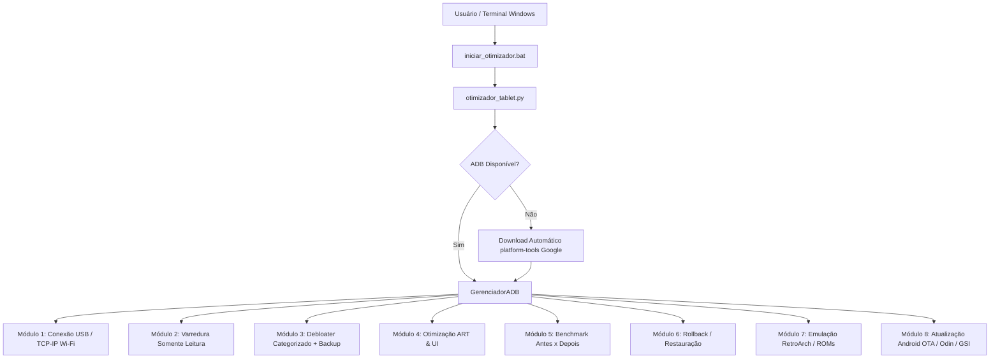

# Especificação Técnica (SPEC) — Sistema de Otimização e Recuperação de Tablets Samsung / Android

**Versão:** 2.0.0  
**Data:** 01/11/2026  
**Status:** Validado em Hardware Real (`SM-X200` e `SM-T510`)  

---

## 1. Visão Geral e Objetivo

Este documento especifica a arquitetura, os requisitos funcionais, os protocolos de segurança e os resultados de engenharia do projeto **Tirando Defeito Programado dos Tablets**.

O objetivo do sistema é recuperar o desempenho, a memória RAM disponível e o armazenamento interno de tablets Android/Samsung antigos ou de entrada **sem exigir acesso root ou desbloqueio de bootloader**, utilizando automação em Python via **ADB (Android Debug Bridge)**, além de prover diagnóstico e suporte para atualização de versão do Android e emulação retrô.

---

## 2. Perfis de Hardware Homologados

| Especificação | Perfil 1: Galaxy Tab A8 | Perfil 2: Galaxy Tab A 10.1 (2019) |
| :--- | :--- | :--- |
| **Modelo / Codinome** | `SM-X200` (`gta8wifi`) | `SM-T510` (`gta3xlwifi`) |
| **Serial de Teste** | `R9XW106990E` | `RX2N7010CWF` |
| **SoC / Plataforma** | Unisoc Tiger T618 | Samsung Exynos 7904 (`universal7904`) |
| **Arquitetura (ABI)** | 64 bits (`arm64-v8a`) | 32 bits em Kernel 64 bits (`armeabi-v7a` / `a64_bvN`) |
| **Memória RAM Total** | ~3,4 GB | ~1,9 GB (2 GB nominal) + 1,3 GB ZRAM/Swap |
| **Sistema Oficial Final** | Android 14 (One UI 6.0) | Android 11 (One UI Core 3.1 — `RP1A.200720.012.T510XXS5CVL1`) |
| **Kernel** | Linux 4.14+ | Linux `4.4.177-22626479` |
| **Perfil de Uso Testado** | Console de Emulação Dedicado (sem Conta Google/Streaming) | Uso Misto / Multimídia (com Streaming, Gmail, YouTube, Fotos e ChatGPT) |

---

## 3. Arquitetura do Software (`otimizador_tablet.py`)



### 3.1. Componentes Principais
1. **`GerenciadorADB` ([`otimizador_tablet.py`](otimizador_tablet.py)):**
   - Localiza binário `adb` no `PATH` ou no diretório local `./platform-tools/adb.exe`.
   - Caso ausente, baixa e extrai automaticamente `platform-tools-latest-windows.zip` do repositório oficial do Google.
   - Gerencia múltiplos dispositivos via flag `-s SERIAL` e suporta transição transparente para **ADB over Wi-Fi** (`adb tcpip 5555`).
2. **Motor de Varredura (`realizar_varredura`):**
   - Operação estritamente *read-only*.
   - Coleta propriedades do sistema (`getprop`), `/proc/meminfo`, `df -h /data`, `dumpsys battery`, escalas de animação, inventário de pacotes (`pm list packages -e/-d/-3`) e políticas corporativas (`dumpsys device_policy`).
   - Exporta laudo técnico auditável para `varredura-tablet.txt`.
3. **Motor de Desinstalação Segura (`menu_remover_bloatware`):**
   - Organiza **105 pacotes mapeados** em **12 categorias funcionais** (cobrindo One UI 3.1 Core até One UI 6.0).
   - Possui lista rígida de proteção (`PACOTES_PROTEGIDOS`) que impede a remoção acidental de componentes vitais (`systemui`, `settings`, `vending`, `gms`, `launcher`, `honeyboard`, `chrome`).
   - Gera antes da primeira alteração o arquivo `antes.txt` e mantém atualizados `removidos.txt` e o script executável `restaurar_apps.bat`.
   - Aplica `pm uninstall --user 0 <pacote>` com fallback automático para `pm disable-user --user 0 <pacote>`.
4. **Motor de Otimização de Runtime ART e UI (`menu_otimizacoes_sistema`):**
   - Desativa atrasos de renderização de transição (`window_animation_scale = 0`, `transition_animation_scale = 0`, `animator_duration_scale = 0`).
   - Executa limpeza profunda de caches (`pm trim-caches 999G`).
   - **Estratégia Híbrida de Compilação ART:**
     - Em aparelhos com espaço livre abundante (> 6 GB livres): `cmd package compile -m speed -f -a`.
     - Em aparelhos com armazenamento restrito (<= 5 GB livres, como o `SM-T510` de 32 GB): aplica `-m speed` nos pacotes críticos de interface (`launcher`, `systemui`, `settings`, `honeyboard`) e `-m speed-profile` nos aplicativos pesados de usuário, evitando inflar `/data/dalvik-cache` em mais de 1,2 GB.

---

## 4. Especificação das Categorias de Bloatware (`CATEGORIAS_PACOTES`)

| ID | Categoria | Alvos Principais | Condição de Remoção |
| :---: | :--- | :--- | :--- |
| **1** | Bixby, Rotinas e Painéis Edge | `spage`, `settings.bixby`, `routines`, `appsedge`, `taskedge`, `cocktailbarservice`, `clipboardedge` | Sempre seguro remover |
| **2** | Nuvem, Conta e Diagnóstico Samsung | `scloud`, `mobileservice`, `scs`, `rubin.app`, `bbcagent`, `dqagent`, `diagmonagent` | Remover se não usar Samsung Cloud |
| **3** | Transferência e Modo Crianças | `smartswitchassistant`, `easyMover`, `kidsinstaller`, `parentalcare`, `forest` | Sempre seguro remover após migração inicial |
| **4** | Compartilhamento e Espelhamento | `sharelive`, `galaxycontinuity`, `mdx.kit`, `smartmirroring`, `allshare`, `beaconmanager`, `mapsagent`, `aware.service` | Remover se não usar espelhamento Smart View / Quick Share |
| **5** | Clima, Vídeo, Foto, Stickers e Temas | `daemonapp`, `vebgm`, `autodoodle`, `photoretouching`, `newtrim`, `DataCreate`, `storyservice`, `stickercenter`, `themecenter`, `dressroom`, `dynamiclock`, `pictureframe` | Sempre seguro remover |
| **6** | Mensagens SMS e Telemetria Knox | `samsung.android.messaging`, `knox.analytics.uploader`, `knox.app.networkfilter`, `knox.attestation` | Manter `messaging` apenas em modelos LTE com chip SIM |
| **7** | Anúncios e Terceiros | `applovin.array.apphub.samsung`, `hiya.star`, `microsoft.office.outlook`, `microsoft.skydrive` | Remover se não usar OneDrive/Outlook |
| **8** | Apps do Google Secundários | `youtube.music`, `photos`, `gm`, `tachyon`, `videos`, `apps.messaging`, `docs`, `maps`, `googlequicksearchbox` | **Seletivo:** manter `gm` e `photos` se o usuário utilizar conta Google ativa |
| **9** | Vozes TTS Estrangeiras | `com.samsung.SMT.lang_*` (`de`, `en`, `es`, `fr`, `it`, `ru`) | Sempre seguro remover |
| **10** | Limitadores e Hub de Jogos Samsung | `game.gos`, `smartfpsadjuster`, `game.gamehome`, `game.gametools` | Recomendado remover para evitar *thermal throttling* precoce |
| **11** | Extras `SM-T510` (One UI Core 3.1) | `kidshome`, `usermanual`, `dictionary`, `dsi.ant.*`, `homemode` (Daily Board), `livestickers`, `icecone`, `watchmanagerstub`, `simplesharing`, `privateshare`, `easysetup`, `stplatform`, `mcfds`, `mcfserver`, `knox.securefolder`, `knox.container*`, `smdms`, `spp.push`, `galaxyfinder` | Sempre seguro remover em tablets sem uso corporativo Knox |
| **12** | Apps de Streaming Pré-instalados | `netflix.mediaclient`, `spotify.music`, `disney.disneyplus`, `amazon.avod.thirdpartyclient`, `youtube.kids` | **Protegido por padrão** quando o tablet é usado para mídia/streaming |

---

## 5. Resultados de Homologação e Benchmark

### 5.1. Caso 1: Samsung Galaxy Tab A8 (`SM-X200` — Android 14 / 3,4 GB RAM)
- **Pacotes ativos:** 333 -> **267** (-66 ativos / 68 desinstalados).
- **RAM Livre:** ~1,4 GB -> **~1,9 GB** após o processo (~1,7 GB estabilizado em uso contínuo).
- **Emulação:** PS1 (*Resident Evil 3* via RetroArch `aarch64`) a 100% e PS2 (*GTA III* via ARMSX2) a ~30 FPS / 100% de velocidade.

### 5.2. Caso 2: Samsung Galaxy Tab A 10.1 (`SM-T510` — Android 11 / 2 GB RAM)
- **Compilação:** `RP1A.200720.012.T510XXS5CVL1` (Kernel `4.4.177-22626479`).
- **Pacotes ativos:** 336 -> **271** (**67 pacotes de bloatware removidos** com 100% de sucesso, preservando todos os apps de streaming, Gmail, YouTube, Google Fotos e ChatGPT).
- **Armazenamento Interno (`/data`):**
  - Antes: **4,0 GB livres** (84% ocupado — 21 GB de 25 GB).
  - Depois: **5,2 GB livres** (79% ocupado — 19 GB de 25 GB) -> **Ganho líquido de +1,2 GB de espaço livre**.
- **Perfil de Memória Pós-Otimização:**
  - Eliminação completa de serviços Samsung/Knox/Bixby/ANT+/DailyBoard do *Top 20* de processos em `dumpsys meminfo`, dedicando toda a RAM de 1,9 GB ao sistema base e aos aplicativos abertos pelo usuário (YouTube, Spotify, Chrome).

---

## 6. Especificação de Atualização de Sistema (Upgrade de Versão Android)

O Módulo 8 (`menu_atualizacao_android`) especifica três rotas técnicas conforme o ciclo de vida do aparelho:

1. **Rota Oficial OTA (`SYSTEM_UPDATE_SETTINGS`):**
   - Indicada quando o aparelho está abaixo da última versão oficial do fabricante (`Android 14` no `SM-X200`; `Android 11 Binário 5` no `SM-T510`).
2. **Rota Oficial via Odin (`reboot download`):**
   - Gravação de imagens oficiais Samsung (`AP`, `BL`, `CP`, `CSC` / `HOME_CSC`) baixadas via *SamFw* ou *Frija* para a região `ZTO` (Brasil).
3. **Rota Custom ROM / Project Treble GSI (`LineageOS 20/21` — Android 13/14):**
   - Necessária para o `SM-T510` (`T510XXS5CVL1`) ultrapassar o limite oficial do Android 11.
   - **Requisitos técnicos para o `SM-T510` (`gta3xlwifi`):**
     - Base de firmware exigida: Bootloader Binário 5 (`XXS5CVL1` ou superior).
     - Arquitetura GSI Treble: `arm32_binder64` (`a64_bvN`) ou builds dedicadas de 64 bits com TWRP empacotado para `gta3xlwifi` (XDA Developers: *Magendanz* / *retiredtab*).
     - Desbloqueio de Bootloader (`OEM Unlocking`) + flash de `twrp_gta3xlwifi.tar` via Odin + `multidisabler` para desativar criptografia forçada (`forceencrypt`) na partição `/data` sob Kernel 4.4.

---

## 7. Protocolo de Segurança e Reversibilidade

1. **Zero Root / Zero Knox Trip na Otimização:** Todas as operações dos módulos 1 a 7 operam sob permissões de shell ADB padrão (`shell` UID 2000), mantendo o bit de garantia **Knox `0x0`** e o `Play Protect` (`verifier_verify_adb_installs = 1`) intactos.
2. **Reversibilidade Total:** Qualquer pacote removido com `pm uninstall --user 0` permanece na partição `/system` ou `/product` (somente leitura) e pode ser restaurado instantaneamente com:
   ```bash
   adb shell cmd package install-existing <NOME_DO_PACOTE>
   ```
   ou executando `restaurar_apps.bat`.

